# Cloud sync v1 contract and launch policy

Status: Phase 1 contract with product decisions updated 2026-10-10. The current server baseline predates end-to-end encryption and must be revised before cloud sync writes are enabled. See [the encryption design](cloud-sync-encryption.md).

The machine-readable HTTP contract baseline is [cloud-sync-v1.openapi.yaml](openapi/cloud-sync-v1.openapi.yaml). It predates the decisions recorded here and must be revised for encrypted envelopes, Paddle billing, and the fair-use policy before implementation is treated as contract-complete. This document defines behavior that OpenAPI alone cannot express: identity boundaries, sync transitions, conflict handling, account policy, and data lifecycle.

## Scope

V1 syncs private, whole-budget snapshots between devices owned by one Budget Warden account. Cloud snapshots are end-to-end encrypted by clients; local `.budget` files and exports remain ordinary portable JSON and continue to work without sign-in or a subscription. Sharing, collaboration, browser editing, attachments, and delta transfer are out of scope. The encryption envelope and key recovery/device enrollment design must be specified before Phase 5 freezes the sync payload.

The current portable schema is version 2. Its JSON uses the Rust model's serialized field names (for example, `schema_version`, `revision_id`, and `amount_planned`). Local location, account identity, cloud membership, and credentials are not part of the portable snapshot. Clients validate schema 2 before encryption and after decryption; the service stores only an opaque encrypted envelope and cannot validate plaintext domain contents. Unsupported cloud schemas or encryption envelopes pause synchronization and preserve pending edits. Existing local legacy-file migration remains supported; an explicitly migrated import may upload its resulting schema-2 snapshot. Newer schemas are never downgraded.

## Identifier and version contract

| Value | Owner and lifetime | Use |
| --- | --- | --- |
| `portable_budget_id` | `BWBudget.id`, created with the portable budget and preserved in exports | Identifies the document lineage. It is not authorization and may occur in more than one cloud resource after an explicit copy/import. |
| `cloud_budget_id` | Client-generated UUID, unique within the authenticated account, allocated and persisted before the first create request | Identifies one cloud resource. It never changes, is never reused, and is never inferred from a file path. The account is derived from the session, not supplied in a route. |
| `device_id` | Random UUID stored in the app's durable per-install client state | Identifies a replica for CRDT timestamps. It is not a cloud resource or an account credential. |
| `mutation_id` | Random UUID allocated once per logical create, replace, delete, billing verification, or checkout | Idempotency key. A retry must reuse the key, exact request bytes, and semantic headers. A changed request is a new mutation with a new ID. |
| `server_version` | Opaque value minted by the service for each accepted snapshot/deletion | Conditional-write version. It is distinct from `revision` and `revision_id` in `.budget`; clients must not parse or order it. Its HTTP representation is the strong `ETag`. |
| `change_cursor` | Opaque, account-scoped service token | Position in the account change feed. It is neither a budget revision nor a server version. Clients persist it only after all changes through it are durable locally. |
| `page_token` | Opaque, account-scoped, short-lived catalog pagination token | Continues one catalog scan. It is not interchangeable with a change cursor. |
| `account_id` / `session_id` | Service-generated UUIDs | Identify an account and one authenticated device session. Neither is embedded in a portable budget. |

Every request is authorized from the authenticated account. Supplying another account's `cloud_budget_id` never grants access; foreign and unknown resources use the same `404` response. The server must not silently create a resource through `PUT`.

## Protocol and snapshot negotiation

All routes use `/v1`. Except `GET /v1/capabilities` and provider webhooks, clients send `Budget-Warden-Protocol: 1`. The capabilities response advertises supported protocol versions, portable schema versions, and size/page limits. An unsupported protocol receives `426 protocol_unsupported`, with supported versions and a minimum app version where available.

Each upload is one complete schema-versioned portable JSON object. V1 does not send patches. Create and replace require an explicit schema version supported by both client and server. If a budget schema is newer or otherwise unsupported, the operation fails with `422 schema_unsupported`; the response includes the received and supported versions. The client preserves its cached snapshot and outbox unchanged and requests an app upgrade. The server never strips fields, changes the schema number, or returns a downgraded snapshot.

The service must validate JSON decoding, schema, portable ID, duplicate entity IDs and JSON keys, valid calendar dates, CRDT map keys and referenced IDs, size limits, checked money totals, and domain invariants before accepting a snapshot. This requires the server-safe decoding and stronger shared validation planned in Phase 2: today's `decode_budget` observes the process-global clock, and `validate_budget` does not perform all these checks. The service must not initialize a fake per-user device clock. It stores the accepted portable snapshot without adding cloud identifiers. Reads carry metadata beside the snapshot; write acknowledgements contain metadata only.

Money, revisions, and clock timestamps can exceed JavaScript's exact integer range. Every transport, JSON parser, database path, and future web integration must preserve signed 64-bit integers exactly; do not round them through floating-point JSON numbers or change the portable format to strings. The OpenAPI schemas specify the Rust integer bounds. Calendar validity and cross-field/CRDT consistency require domain validation in addition to JSON Schema.

## HTTP operation semantics

See the OpenAPI file for request and response shapes. These rules are normative:

1. **Create:** the client persists a fresh `cloud_budget_id` and `mutation_id` before making `POST /v1/budgets`. The client validates the portable snapshot, encrypts it, and sends an envelope. The server validates envelope/metadata consistency, reserves that account-scoped cloud ID, stores ciphertext, allocates a server version and account change entry, and records the mutation receipt atomically. Retrying the same create returns the original result. The same cloud ID with different content or a different create mutation is a conflict; a deleted cloud ID cannot be reused.
2. **Read:** `GET /v1/budgets/{id}` returns the current full snapshot and strong `ETag`. `If-None-Match` may return `304` when unchanged. A change-feed upsert only signals that a resource changed; clients fetch it with this route.
3. **Replace:** `PUT /v1/budgets/{id}` requires `If-Match` and `Idempotency-Key`. The server checks owner, active entitlement, snapshot limits/schema/identity, and expected version. It atomically commits the replacement, new opaque server version, feed row, and idempotency receipt. A stale version returns `409 version_conflict` with the current version; the client then downloads, reconciles, persists, and retries with a new mutation ID and the new `If-Match` value. The old mutation ID is reserved for retrying the original exact request.
4. **Delete:** `DELETE /v1/budgets/{id}` requires `If-Match` and `Idempotency-Key`; it is allowed to a signed-in owner even if the subscription has expired. Deletion makes the snapshot inaccessible immediately and commits a deletion feed entry. The small resource tombstone remains while the account exists. A stale device receives `410 resource_deleted` and must retain unsynced edits as a recovery copy; it must never recreate that resource automatically.
5. **Idempotency:** keys are scoped by account, method, and concrete resource route. The request digest covers exact encrypted body bytes and semantic headers, including `If-Match`; changing either under a committed key returns `409 idempotency_key_reused`. After authentication/ownership checks, look up a committed receipt before checking entitlement or the expected version again. Keep digests and content-free successful outcomes for at least 400 days, except when account deletion requires their removal. Create/replace receipts retain IDs, the original server version, and commit time, never encrypted budget payloads, titles, payment credentials, or checkout/portal URLs. A replay acknowledges the original operation; it does not claim that version is still current or recreate data deleted later. Clients fetch current state separately when needed. Rejected, uncommitted operations do not permanently cache transient auth or entitlement failures. After receipt expiry, resolve an uncertain create by reading its preallocated cloud ID: an active resource with the expected portable ID must be reconciled, `404` means the unused ID may be retried with a new mutation ID, and `410` means the ID cannot be reused. Resolve old replace/delete attempts against current state before retrying.
6. **Atomicity:** a successful write commits the snapshot/deletion state, server version, account feed entry, and idempotency receipt together. No success response may precede that commit.
7. **Limits:** measure encrypted payload size in bytes and enforce bounded request/per-snapshot technical limits to protect service availability. There is no published fixed per-account storage quota; unusually high usage is handled under a fair-use/support policy. `413 snapshot_too_large` identifies the technical per-snapshot maximum. `429 rate_limited` includes `Retry-After`. Do not reject an otherwise valid replacement because the account crosses an unpublished quota, and do not silently delete current budgets. Error codes are stable machine identifiers; human text is not a program interface.

All application errors use `application/problem+json` with stable `code`, HTTP `status`, `request_id`, and optional machine-readable `details`. Mapping: `invalid_request` or `challenge_expired` (400); `session_expired` or `invalid_provider_proof` (401); `entitlement_required`, `reauthentication_required`, or `account_deletion_pending` (403); `not_found` (404); `version_conflict`, `idempotency_key_reused`, `cloud_id_in_use`, `identity_already_linked`, `purchase_claimed`, or `entitlement_already_active` (409); `resource_deleted`, `cursor_expired`, `page_token_expired`, `cloud_retention_expired`, or `checkout_expired` (410); `snapshot_too_large` (413); `invalid_envelope` or `encryption_unsupported` (422); `protocol_unsupported` (426); `rate_limited` (429); `internal_error` (500); and `service_unavailable` (503). Missing/malformed required headers are `400 invalid_request`. A version conflict includes the current version; unsupported schema/encryption errors include received and supported versions. Clients branch on `code`, never on `detail` text. Provider webhook ingress may use the provider's required error envelope.

Authentication/token, snapshot, and billing-link responses use `Cache-Control: no-store` so HTTP intermediaries do not retain credentials, budgets, or short-lived payment links. App-owned durable snapshot caching is separate from HTTP caching.

### Catalog bootstrap and change feed

The first `GET /v1/budgets` page includes a `bootstrap_cursor` captured before its catalog read. The catalog is sorted by immutable `cloud_budget_id`; later pages use `page_token` bound to the account, bootstrap cursor, last cloud ID, and original page size. Page tokens expire after 24 hours; an expired token returns `410 page_token_expired`, and the client restarts without treating a partial scan as deletion evidence. Changes committed after the bootstrap cursor may also appear in the live catalog; replaying them is an allowed duplicate. Finish and durably apply every catalog page before comparing missing resources or saving the bootstrap cursor as the feed's starting position. Then replay changes **after** that cursor; the catalog alone does not establish that the client is caught up. If the bootstrap cursor expires during the scan, restart bootstrap.

Every cloud-budget mutation, including retention deletion, receives a monotonically increasing account sequence inside the same database transaction that commits its change-feed row. Sequence allocation is serialized per account through commit, so a cursor cannot advance past a still-uncommitted earlier change. Feed pages are ordered; an upsert includes resource ID, version at that commit, schema, and change time; a deletion includes resource ID, deletion time, and reason (`user_deleted` or `retention_expired`). Feed entries are replayable and processing is idempotent.

An upsert version describes that committed event. A subsequent GET may return a newer version or `410`; apply the fetched current state or deletion and never wait for the old version to reappear. Advance `next_cursor` only through events fully applied or durably queued for recovery. A feed high-water mark can advance on an empty page only through committed sequences; `has_more: false` describes that response's read position, not a guarantee that no future changes will arrive.

If a cursor predates retained feed history, `GET /v1/sync/changes` returns `410 cursor_expired`. The client performs a complete paginated catalog scan, checks every cached cloud resource against the fully read catalog, downloads versions that changed, preserves pending local work for missing/deleted resources, and only then saves the new cursor. A partially read page sequence can never establish deletion.

## Client sync state machine

The durable cache, outbox, account ID, session generation, and cloud-resource mapping are account-scoped. A local edit is written to durable storage before the app reports it saved. Account switches stop requests from the old session generation and cannot route one account's cache to another.

```mermaid
stateDiagram-v2
    [*] --> LocalOnly
    LocalOnly --> CreatePending: choose cloud; persist cloud ID and snapshot
    CreatePending --> Syncing: online, protocol/schema supported, entitlement allows write
    CreatePending --> OfflinePending: offline or entitlement unavailable
    OfflinePending --> Syncing: connectivity and write entitlement return
    Syncing --> Synced: accepted version; uploaded generation is still current
    Synced --> Dirty: local edit persisted
    Synced --> Syncing: remote change discovered
    Syncing --> Dirty: accepted version; newer local generation exists
    Dirty --> Syncing: schedule next pass
    Syncing --> Conflict: server version changed
    Conflict --> Syncing: fetch, reconcile, persist, retry with new mutation ID
    Syncing --> OfflinePending: transient network/server failure
    Syncing --> SignInRequired: session cannot be refreshed
    Syncing --> SubscriptionRequired: server rejects create/replace entitlement
    Syncing --> UpgradeRequired: unsupported protocol or snapshot schema
    Syncing --> QuotaExceeded: upload exceeds storage allowance
    QuotaExceeded --> Syncing: storage reclaimed or smaller snapshot queued
    SignInRequired --> Syncing: account session restored
    SubscriptionRequired --> Syncing: verified write entitlement returns
    UpgradeRequired --> Syncing: compatible client installed
    Syncing --> RecoveryCopy: resource was deleted remotely
```

Operational rules:

- Before upload, capture the durable local generation and last acknowledged server version. Fetch remote state when its version changed; reconcile with the latest local snapshot using the Rust core, then persist the result before uploading.
- Serialize work per cloud budget. Keep the original request bytes and mutation ID while the result is uncertain. On a version conflict, fetch the current snapshot, merge, persist, and retry a bounded number of times. A retry that changes snapshot bytes gets a new mutation ID.
- Persist an outbox entry before sending and persist its acknowledgement with the server version and accepted generation. After a crash, replay the exact pending request with the same mutation ID; if the receipt has expired, resolve through the resource read rules above before retrying.
- On acknowledgement, atomically store the new server version and acknowledged local generation. If local edits arrived during flight, keep the budget dirty and schedule another pass; never replace newer local edits with an older response.
- Refresh an access token once after `401 session_expired` on an application request and retry the same request. A second session failure pauses in `SignInRequired`; invalid provider proofs are corrected through the provider sign-in flow, not a session refresh loop. `403 entitlement_required` pauses uploads but leaves the cache editable and exportable. `422 schema_unsupported` pauses sync pending an app upgrade. Network errors, `408`, `429`, and `5xx` retain the outbox and retry with bounded exponential backoff and jitter, honoring `Retry-After`.
- Pause on `413 snapshot_too_large` and show the technical per-snapshot limit. Preserve edits; resume after an explicit smaller upload. `426 protocol_unsupported` also enters `UpgradeRequired`. Coalesce edits that have not been sent, but retain immutable encrypted bytes for an uncertain in-flight mutation. Logout stops requests and clears credentials while retaining account-scoped recovery data; late responses cannot change the new session's active state.
- `410 resource_deleted` changes the linked cache to a local recovery copy. It does not enqueue a new cloud create. Re-creation requires a user-visible explicit copy operation with a new cloud ID.
- `410 cloud_retention_expired` uses the same local recovery behavior. A size-limit recovery must never silently discard CRDT tombstones or change records to make a snapshot fit; the user can keep working locally and export it.
- Process feed entries idempotently. Persist the cursor only after all work through it is durable. On cursor expiry, do the complete bootstrap described above.
- Offline edits are accepted regardless of the last entitlement refresh. The server is authoritative when a request next reaches it; entitlement failure does not erase or block export of pending edits.

## Identity, security, and privacy decisions

- Google and Apple issuer/subject pairs are distinct identities. Do not auto-link by matching email; linking requires an authenticated session plus proof of control of the second identity. Support Apple private relay addresses and first-login-only profile fields.
- The client generates and durably stores its device UUID before sign-in and sends it with the auth challenge. The server associates that UUID and platform metadata with the resulting session; it is not a secret or an authorization credential.
- Provider sign-in uses a one-time server challenge with state and nonce, expiring after 5 minutes. Bind it to provider, configured client/audience, allowlisted redirect, platform, device, and purpose. Link/reauthentication/deletion challenges also require and bind the existing account/session. Completion cannot change those bindings or consume a link challenge through the ordinary sign-in endpoint. Use authorization code plus PKCE where the configured provider flow supports it; the API must also accept authorization codes without PKCE for flows that do not. Require the verifier when the stored challenge requires PKCE. Validate issuer, signature/allowed algorithm, audience, expiry, nonce, and redirect. Link completion and account deletion require a purpose-bound reauthentication proof no older than 5 minutes, bound to the current account/session and consumed on success. Provider credentials are exchanged for Budget Warden sessions and are not general API bearer tokens.
- A verified store purchase is bound to one internal account. If another account already owns it, return `409 purchase_claimed` and require the documented support/transfer path; do not silently move it or create a second entitlement. Duplicate, reordered, or replayed provider notifications are idempotent, and stale notifications cannot overwrite newer verified subscription state.
- Require account correlation for new purchases: Apple's `appAccountToken` is the internal account UUID; Google's `obfuscatedAccountId` is the lowercase SHA-256 hex digest of that canonical lowercase UUID string. These correlation values are not credentials. Compare them against provider-verified transaction/purchase data, never a client-supplied assertion. Validate the app/package, environment, and allowlisted product ID as well as payment state. Unknown webhook purchases remain unbound until verified correlation identifies their account; never associate them by email. Periodically reconcile subscriptions with provider APIs to repair missed/reordered notifications, retaining the last verified paid/grace deadline when a provider is unavailable.
- Identity linking first reauthenticates the existing account (`purpose: reauthenticate`), then proves the second provider through a separate `purpose: link_identity` challenge. Submit both the second provider proof and the recent-account proof to the link endpoint. `purpose: delete_account` issues a deletion-only proof. These flows cannot substitute one purpose's proof for another.
- Access tokens expire within 15 minutes. Refresh tokens are opaque, device-session scoped, stored hashed server-side, rotated on every use, and revocable; each rotated token expires within 30 days unless refreshed. Refresh-token reuse revokes its token family. Native apps store credentials in platform secure storage; the sync database/cache never stores refresh tokens.
- Serialize refresh calls for a session across workers/processes and atomically persist the rotated credentials before using them. A lost refresh response or a crash before persistence leaves an uncertain rotation: require provider sign-in rather than blindly retrying the old token and triggering reuse revocation. Successful sign-in on the same install revokes its obsolete session family. Revocation/account deletion must be checked on protected requests so a still-unexpired JWT cannot retain access. See [OAuth security best practice, refresh-token protection](https://www.rfc-editor.org/rfc/rfc9700.html#section-4.14).
- Require recent authentication for identity linking and account deletion. Account IDs in API routes are omitted. Resource authorization is checked on every request. Do not log budget snapshots, provider credentials, access/refresh tokens, or payment tokens.
- V1 uses TLS 1.2 or later in transit and managed encryption at rest for database, backups, and object storage if introduced. V1 is **not** end-to-end encrypted: the service can process plaintext budget snapshots. Do not promise E2EE. Publish this before upload; a future E2EE design requires key recovery and multi-device decisions before changing the payload contract.
- Budget exports are the ordinary portable `.budget` snapshot. Exporting or importing a file does not establish account access or reconnect it to a cloud resource. An import/copy creates a new cloud resource only after explicit user action. A move keeps the original local file as a backup after upload succeeds.

## Entitlement and retention policy

Signing in is free. Creating cloud resources and replacing snapshots require an active monthly entitlement or an explicit provider-confirmed grace state that grants access. Snapshot downloads remain available for 90 days after effective access ends so users can export. Catalog/change-feed access and deletion remain available while signed in, including after expiry, to discover retained resources and deletions. Resources beyond their retention deadline are excluded from the live catalog and return `410 cloud_retention_expired`, even if the physical purge job is delayed. Local editing/export and queued offline edits are never disabled by account status.

| Provider event/state | Create or replace | Catalog/read/export | Client behavior |
| --- | --- | --- | --- |
| Active | Allowed | Allowed | Sync normally |
| Provider-confirmed access-granting grace | Allowed until provider grace ends | Allowed | Show grace status; continue sync |
| Payment retry/account hold without paid or grace access | Denied | Downloads during 90-day export window | Show billing issue; pause uploads |
| User cancels | Allowed through paid-through date | Allowed | Cancellation does not immediately revoke access |
| Expired or refunded/revoked | Denied at effective expiry | Allowed for 90 days from effective expiry | Keep cached edits; export; pause uploads |
| 90-day retention end | Denied | Cloud snapshots and recovery versions purged | Local cache remains exportable; report cloud resource unavailable |

Recommended retention/account behavior:

- Payment retry alone does not grant access. Apple billing retry outside Billing Grace Period and Google Play account hold/paused/pending purchases do not extend writes. Paddle's verified subscription state and paid-through date determine access; payment failure alone grants no additional grace unless Paddle confirms an access-granting state. A successful verified payment extends access. [Apple Billing Grace Period](https://developer.apple.com/help/app-store-connect/manage-subscriptions/enable-billing-grace-period-for-auto-renewable-subscriptions/), [Google Play subscription lifecycle](https://developer.android.com/google/play/billing/lifecycle/subscriptions), [Paddle subscription lifecycle](https://developer.paddle.com/build/subscriptions/overview/).
- Store every verified subscription separately, including accidental overlaps across providers. Effective access is the union of their valid paid/grace intervals: a refund or expiry of one subscription cannot revoke another active subscription. Return all subscription management sources in the entitlement response. `can_create`/`can_write` express subscription permission; a specific write must still pass request bounds and client-side validation. Avoid additional purchases when any subscription grants access and explain overlapping charges if they occur.

- Retain up to two previous accepted snapshots per budget, at most 30 days, for service recovery; current snapshots plus retained history count against account storage limits. Client conflict recovery remains client-owned.
- Change-feed rows are retained for 90 days. An older cursor expires and requires a full catalog reconciliation.
- Explicit budget deletion removes live and recovery snapshots from normal service access immediately. Preserve a content-free tombstone and ID reservation until account deletion completes; never reuse the cloud ID.
- When subscription retention expires, atomically emit a `retention_expired` deletion change and preserve a content-free resource marker/ID reservation while the account exists. Serialize purge with entitlement changes and writes under the account lock, and re-check effective access/deadline in that transaction; an account renewed before the deadline must not be purged by an already queued job. Show the deletion date and give advance notice before expiry of the export window. Re-subscribing after the deadline does not restore expired resources or reconnect an old cache, even if physical purge is delayed; the user must explicitly create a new cloud copy with a new cloud ID.
- Account deletion revokes sessions and cloud access immediately and schedules live account data deletion within 30 days. Durably cancel every Paddle subscription and expire open checkout sessions where supported, retrying provider failures while retaining only the minimal billing linkage needed to finish cleanup. Return applicable App Store/Google Play management links because account deletion does not cancel store subscriptions. Auth challenges and billing notifications cannot recreate an account pending deletion; provider sign-in returns `403 account_deletion_pending` with the purge date until deletion finishes. A later fresh account receives a new ID and no old cloud resources. Encrypted backups expire within 35 days after live data purge, so the account-deletion maximum is 65 days including backups. Explicit budget deletion and retention purge use the same 35-day backup age-out after live purge. Retain only purchase/tax records required by law, detached from budget content where possible.
- Cancellation, expiry, refund, account deletion, and budget deletion are separate actions. Expiry never implies account deletion; removing a cache never implies cloud deletion.
- `effective_expires_at` is the end of effective account access across all verified subscriptions, including access-granting grace, or the verified revocation time if all remaining access is revoked. The 90-day read/export window starts when the last such access ends. Recovery before the deadline preserves cloud resources and resets the deadline on a later lapse. Accounts that never subscribed have no retention deadline. Honor provider-confirmed grace; do not infer it from payment retries or a client clock.

## Working launch policy

| Decision | Provisional recommendation |
| --- | --- |
| Monthly price | One configurable plan, reference price USD $1.99/month, with localized storefront pricing. Includes an unlimited number of cloud budgets for ordinary personal use. |
| Hosting region | EU hosting target; select the concrete region before staging/production deployment and keep database and encrypted backups in the EU. |
| Fair use and technical limits | No published fixed account storage quota and no budget-count cap. Contact users whose usage appears unusually high (for example, around 200 GB) under a clear fair-use policy. Retain per-snapshot and request-body technical bounds to protect service availability; retain bounded recovery history. Do not silently delete user budgets. |
| Request limits | Default page size 50, maximum 100; 60 authenticated reads/minute and 30 writes/minute/account; 10 auth starts per 10 minutes per IP and account where known. Return `429` and `Retry-After`; tune from staging data. |
| Idempotency | Keep request digest and content-free successful mutation metadata at least 400 days, subject to account deletion. Resource IDs and deletion tombstones remain reserved for the account lifetime. Never retain snapshots in receipts. |
| Feed and deletion retention | Change feed 90 days; subscription expiry permits read/export for 90 days, then cloud snapshots and recovery history are purged; budget tombstones remain content-free while the account exists. |
| Account deletion | Revoke access immediately, purge live account data within 30 days, and expire encrypted backups within 35 days of live purge (65 days maximum from the request). Cancel Paddle subscriptions through Paddle; store subscriptions must also be canceled in their storefront. |
| Billing | StoreKit 2 for Apple App Store builds; Google Play Billing for Play-distributed Android; Paddle as the working merchant of record for desktop Windows and Linux. Keep provider adapters behind one provider-neutral account entitlement service. |
| Grace | Honor explicit provider-confirmed access-granting grace. Payment retry/account hold alone does not extend access. |
| Encryption | TLS in transit, managed encryption at rest as defense in depth, and required client-side end-to-end encryption for cloud snapshots. Local files/exports remain plaintext portable `.budget` JSON. |

### Billing channel recommendation

Use one Budget Warden account entitlement, with each payment source recorded and verified separately. The user signs in before purchasing; the service checks the account's existing entitlement before presenting a new purchase. Do not match purchases to accounts by email or grant access based only on a client-side purchase flag.

- **iOS and Mac App Store:** use StoreKit 2 auto-renewable subscriptions. If the iOS and macOS clients are separate App Store apps, configure an equivalent subscription product for each app and verify transactions server-side. Before showing a purchase option in either app, check whether that Budget Warden account already has an active subscription from Apple, Google Play, or Paddle; propagate it across the apps and avoid a duplicate charge. Apple's guidance for multi-app subscriptions calls for a unified account database and server-side status validation. [Apple: offering a subscription across multiple apps](https://developer.apple.com/documentation/storekit/offering-a-subscription-across-multiple-apps), [Apple: StoreKit and IAP setup](https://developer.apple.com/help/app-store-connect/configure-in-app-purchase-settings/overview-for-configuring-in-app-purchases/).
- **Android distributed through Google Play:** use Google Play Billing for the subscription purchase and restore flow. Cloud sync is a paid digital service, and Play's default rule requires its billing system for in-app access to cloud services. Do not show a Paddle checkout link or direct users to buy through the website from the Play build. Consider an alternative billing program only if a target market justifies its enrollment and reporting requirements. [Google Play Payments policy](https://support.google.com/googleplay/android-developer/answer/9858738?hl=en).
- **Windows and Linux desktop clients:** use Paddle as the current merchant-of-record choice for the account-level monthly plan. Start checkout from an authenticated Budget Warden account, associate the Paddle customer/subscription with the internal account using server-controlled correlation data, and grant access only after verified Paddle notifications/API state. Keep this provider replaceable; do not store provider-specific assumptions in the entitlement model. Confirm Paddle merchant eligibility, desktop distribution terms, actual fees, and localized pricing before launch.
- **Windows distributed through Microsoft Store:** Windows budgeting software is a non-game PC product. Microsoft Store policy version 7.20, scheduled to take effect on 22 October 2026, permits non-game PC products to use a secure third-party purchase API or Microsoft recurring billing, subject to its transaction, disclosure, and Partner Center requirements. Paddle is the working choice for desktop billing; confirm the effective policy and Paddle terms at submission. [Microsoft Store financial transaction policy](https://learn.microsoft.com/en-us/windows/apps/publish/store-policies), [Microsoft Win32 Store distribution options](https://learn.microsoft.com/en-us/windows/apps/distribute-through-store/how-to-distribute-your-win32-app-through-microsoft-store).
- **Storefront boundaries:** a user with an existing Paddle desktop subscription can sign in to Apple or Play builds and use the account entitlement. Keep native purchases available where required. External purchase links and subscription-management flows must follow each storefront's current rules. Apple's multiplatform rule permits access to subscriptions acquired elsewhere when the same service is also offered as in-app purchase. [Apple App Review Guidelines, 3.1.1(a) and 3.1.3(b)](https://developer.apple.com/app-store/review/guidelines/#multiplatform-services), [Google Play Payments policy](https://support.google.com/googleplay/android-developer/answer/9858738?hl=en).

This creates three provider adapters (Apple, Google Play, Paddle), but one entitlement service and one plan. Store subscriptions remain managed in their store; Paddle subscriptions use Paddle's customer portal. The app should always show which provider bills the user and link to that provider's management flow. USD $1.99 is the configurable reference price; confirm localized prices and net revenue after provider fees and taxes before launch.

For Paddle, create checkout transactions under an account lock, reuse an existing unexpired checkout where supported, and reject a new checkout while effective access exists. Server configuration chooses the Paddle price and allowed return destinations; the client supplies no arbitrary price or redirect. Link customer/subscription metadata to the internal account and retain durable billing-event deduplication before acknowledging notifications. A signed event must be reconciled against verified subscription state before granting access. If another provider activates while checkout is open, expire that checkout when supported. Cross-provider races can still create overlapping subscriptions, which must be reported and managed rather than discarded. Keep billing provider identifiers and lifecycle state in provider-specific records so a later provider change does not alter cloud entitlement or encryption data.

Billing verification retries return the current verified entitlement from the account's subscription records, rather than replaying an obsolete access decision. Checkout receipts retain provider transaction/session IDs and expiry, not a payment URL; an exact retry reuses the same unexpired checkout where supported. An expired checkout returns `410 checkout_expired`, and requesting another requires a new mutation ID. Portal-session creation is intentionally not a durable idempotent mutation. Complete Google Play purchase acknowledgement and Apple transaction finishing as required after durable verification; pending purchases never authorize uploads. [Google Play purchase processing](https://developer.android.com/google/play/billing/lifecycle/subscriptions).

The term **unlimited budgets** means no fixed budget-count or published account-storage limit for ordinary personal use. Apply request and per-snapshot technical bounds to protect service availability, and use a fair-use/support process for unusually high usage (for example, around 200 GB). Do not silently delete current budgets. Keep local editing and export available. Recovery history is bounded service recovery, not a guaranteed user-visible backup product.

## Architecture decisions

1. **Keep portable data portable.** Cloud membership, account IDs, cache paths, sessions, and server versions live in client metadata, not `.budget` JSON. A cloud resource contains one portable snapshot plus owner-scoped metadata.
2. **Use full snapshots and optimistic concurrency for v1.** HTTPS `POST` creates, `GET` reads, conditional `PUT` replaces, and conditional `DELETE` removes. PostgreSQL commits data, version, feed position, and idempotency result in one transaction. Revisit object storage and delta sync only after measuring snapshot sizes and volume.
3. **Keep reconciliation in the shared Rust domain.** The client fetches, decrypts, merges, validates, encrypts, and persists before retrying. The service validates envelope metadata and stores ciphertext but does not inspect plaintext, merge replicas, or depend on process-global user/device state.
4. **Keep transport/runtime separate and optional.** The core domain remains usable with networking disabled. Protocol DTOs and pure reconciliation do not require Tokio/HTTP. Add a default-off `cloud-sync` feature for client transport and enable it only in app binding builds.
5. **Use server-owned ordering.** Per-account change sequences serialize through database commit. Opaque cursors cannot reveal an uncommitted predecessor. Cursor expiry invokes a full scan, not partial deletion inference.
6. **Use account-scoped cache and a durable outbox.** Each edit is durable before UI acknowledgement. Account switching isolates queues and caches; pending edits survive logout. App location uses explicit local/cloud handles rather than a fake URL.
7. **Use provider-verified account entitlements.** Store receipts, webhooks, and restore flows update a server-owned entitlement. Client purchase flags never authorize writes. App Store, Play, and Paddle subscriptions map to the same internal plan/account.
8. **Keep deletion explicit and non-resurrecting.** Resource tombstones prevent ID reuse; expired cursors force a catalog rescan; stale clients preserve unsynced work as local recovery data.

## Phase 1 gate

The product direction is recorded: configurable USD $1.99 reference price, no published account storage cap, EU hosting target, 90-day export window, Paddle desktop billing, native Apple/Google store billing, and end-to-end encryption for cloud snapshots. The full phase gate remains open: update OpenAPI and the service from plaintext snapshots to encrypted envelopes, settle the exact crypto suite and recovery UX, and verify the contract against the implementation. Phase 2 must establish convergent reconciliation and shared validation before cloud writes are enabled.
